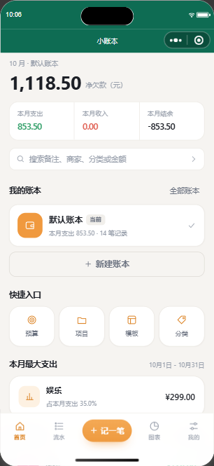
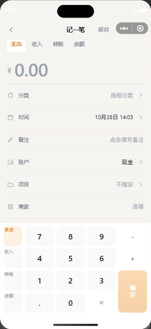
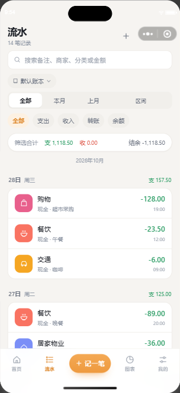
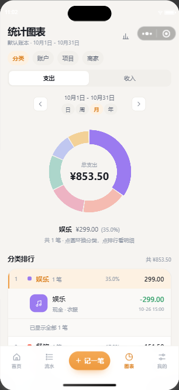
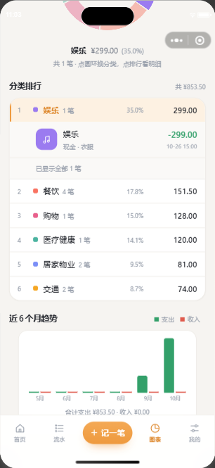

# 半寸册

> 一个不联网也能用的微信小程序记账本。数据只存在你自己的手机里。

名字是字面意思：一本只有半寸厚的册子——记的都是零碎小账，攒起来就是一年的生活。打开就记，不注册、不登录、不上传、不看广告。

当前版本 **1.1.1**（微信小程序）。

<p align="center">
  
  
  
  
  
</p>

---

## 特性

| | |
| --- | --- |
| **纯本地** | 全部数据存本机 `wx.setStorageSync`，没有服务器、没有账号体系、没有埋点 |
| **无广告** | 没有任何广告位、跳转、诱导分享 |
| **多账本** | 生活 / 工作 / 家庭分开记，首页点卡片即切换，互不干扰 |
| **账户** | 现金、支付宝、微信钱包、储蓄卡、信用卡 5 个默认账户，可自行增删；信用卡默认不计入净资产 |
| **分类** | 84 个预设分类（15 个一级 / 69 个二级），支出收入分开，可改可删可加 |
| **预算** | 按账本、按月设总预算，首页显示已用比例 |
| **项目 / 模板** | 旅行、装修这类一次性开销归到项目；常用记账组合存成模板，一键复用 |
| **统计** | 环形占比图 + 分类排行，点分类展开该类的明细条目；支持本月 / 上月 / 区间 / 全部 |
| **流水** | 按月、按天两级分组，每次加载 30 条；加载边界对齐到整天，不会出现某天只显示一半导致日合计跳变 |
| **本机存档** | 每次改动后自动把当前账本写成 Excel（5 张工作表），存在小程序自己的文件区 |
| **备份恢复** | 可导出完整 JSON 备份到微信聊天存起来，换手机时靠它恢复；也保留上一版数据可回滚 |

## 技术栈

- **Taro 4.3.1** + **React 18.3** + **TypeScript 5.6**，编译目标 `weapp`
- **Zustand** 管状态，写入走 250ms 防抖后再分片落盘
- **Sass** 写样式，`designWidth: 375`（1px → 2rpx）
- **零运行时依赖**做导出：xlsx 由手写 OOXML + STORE 版 ZIP（含自实现 CRC32）生成，省掉 SheetJS 约 900KB 的体积

## 本地跑起来

前置：Node.js 18+、[微信开发者工具](https://developers.weixin.qq.com/miniprogram/dev/devtools/download.html)，并在工具里登录一个有小程序权限的微信号。

```bash
npm install

# 编译到 dist/
npm run build:weapp

# 打开微信开发者工具（或手动导入 dist/ 目录）
npm run ide

# 开发模式：改代码自动重编
npm run dev
```

`dist/` 不进版本库。**克隆后必须先 `npm run build:weapp`**，否则开发者工具打开 `dist/` 会是空的；回退到旧 tag 后同理。

`project.config.json` 里带的是本项目的 AppID。换成你自己的 AppID 后需要重新编译。

### 端到端验收

项目自带 16 套验收脚本（共 394 项断言），通过 `miniprogram-automator` 直接驱动真实的微信运行时。

```bash
# 必须和 auto 串在同一条命令里：auto 结束端口即释放
npm run auto >/dev/null 2>&1 && node scripts/verify-weapp.cjs

# 批量回归要给 timeout，端口异常时脚本不会快速失败而是挂住
timeout 120 npm run auto >/dev/null 2>&1 && node scripts/verify-ledger.cjs
```

脚本通过 `globalThis.__ledgerStore` / `__ledgerArchive` 直接读写 store 来造数据与断言。这两个调试钩子在 `envVersion === 'release'` 时不挂载，正式版干净。

| 脚本 | 覆盖 |
| --- | --- |
| `verify-weapp` | 冷启动冒烟、11 页可渲染 |
| `verify-empty` | 首启空数据（「审核员视角」）：11 页逐页 reLaunch，断言空态不白屏 |
| `verify-record` / `verify-record-branches` | 记账主链路与分支（金额键盘、分类切换、日期、支出/收入） |
| `verify-ledger` / `verify-ledger-paging` | 流水分组、筛选、30 条分页与整天切边 |
| `verify-stats` | 图表聚合、排行、明细展开与折叠 |
| `verify-accounts` / `verify-categories` / `verify-books` / `verify-budget` / `verify-manage` | 各管理页增删改 |
| `verify-settings` / `verify-backup` / `verify-archive` | 设置项、备份恢复、xlsx 存档 |
| `verify-hover` | 静态守卫：产物与源码不允许出现 `:hover` / `:active` |

另有 `npm run typecheck`（`tsc --noEmit`）作为提交前必过项。

## 目录结构

```
src/
├── pages/            # 11 个业务页
│   ├── home/         # 首页（净资产 + 本月收支 + 账本切换）
│   ├── record/       # 记一笔
│   ├── ledger/       # 流水
│   ├── stats/        # 统计图表
│   ├── settings/     # 我的
│   └── accounts/ categories/ books/ budget/ projects/ templates/
├── components/       # Keypad / Sheet / TabBar / DonutChart / TxRow / Icon …
├── db/
│   ├── storage.ts    # 存储驱动：wx.setStorageSync + 分片（300 条/片）
│   ├── persist.ts    # 反序列化、迁移、备份轮转
│   ├── seed.ts       # 预设账户与 84 个分类
│   ├── archive.ts    # 本机 xlsx 存档调度
│   ├── xlsx.ts       # 手写 xlsx（ZIP + OOXML）
│   ├── dataIO.ts     # 导出 / 导入完整备份
│   └── sync.ts       # 云同步接口占位，默认 localOnly
├── store/            # Zustand store 与 selector
├── hooks/            # useAmountInput / useProgressiveList / useNavMetrics
├── utils/            # 日期、金额、id
└── styles/           # 全局变量与页面公共样式

scripts/              # 验收脚本、截图工具、微信 CLI 包装
docs/screenshots/     # README 用图
```

## 数据存在哪

这是最需要说清楚的一件事，因为它决定了「会不会丢」。

**两层存储，配额独立，互不挤占：**

| 位置 | 存什么 | 配额 | 会不会被清掉 |
| --- | --- | --- | --- |
| `wx.setStorageSync`（键前缀 `ledger-app.*`） | 全部流水、账户、分类、预算、设置 | 10 MB | 用户清缓存 / 卸载小程序会清 |
| `USER_DATA_PATH/archive/` | 每账本一个 `.xlsx`，另加 3 份 JSON 滚动快照 | 200 MB | 只在代码包变动时可能被清 |

**关键认知：文件存档防不了「清缓存」。** 微信官方口径是本地用户文件只随代码包更新被清理，但手动清缓存、卸载、换手机都会丢。**唯一能跨设备保命的路径是「导出完整备份」→ 发到微信聊天存起来 → 新手机「从备份恢复」。**

「发送最新存档到聊天」发的是 xlsx，只是给人看的档案，**不能用来恢复数据**；导入入口只接受 `.json`。这两件事在界面上是分开的，文案也写死了区别。

## 隐私

- 不采集、不上传任何数据。没有服务端，也就没有可上传的去处。
- 用到的两个敏感接口，都只在用户主动点击时触发：
  - `wx.chooseMessageFile` —— 从聊天记录里选一个 `.json` 备份文件来恢复
  - `wx.setClipboardData` —— 导出备份时的降级路径（写不进文件就复制到剪贴板）
- 不申请相册、位置、通讯录、相机等任何其他权限。

## 开发约定

踩过的坑，留在这里免得再犯：

- **移动端禁用 `:hover` / `:active`**。触摸设备上 `:hover` 松手不解除，是「点过一行就一直发灰」的根因。一律用 `hoverClass` 挂 `--hover` 类；`<Text>` 不支持 `hover-class`，需要按下的元素用 `<View>`。有 `verify-hover` 双向守卫。
- **选中态与按下态必须视觉可分**。全站选中态用 `accent-soft` 底 + `accent-deep` 字，禁止拿 `surface-2` 当选中底色——它和按下态同色。
- **不留「点了才说没做」的占位入口**。审核会记「功能不完整」，且不调对应 API 就能少一项隐私声明。要么做完，要么不留入口。
- **版本号有三个手动位置，彼此无自动关联**：`src/pages/settings/index.tsx` 的 `APP_VERSION`（「关于」里显示的那个）、`package.json` 的 `version`、以及 `cli upload -v` 的参数。三处要一起改，漏了就会出现「界面显示 1.1.0、后台记录 1.1.1」这种对不上的情况。
- **预设数据改名必须走迁移**。改 `seed.ts` 对老用户无效，得在 `persist.ts` 里配一条「id + 旧名」双命中的重命名规则，并递增 `DATA_VERSION`。
- **`cli auto` 的端口随命令结束立即释放**，验收脚本必须与它串在同一条命令里（见上）。

## 发布

```bash
# 上传前先改 APP_VERSION
npm run build:weapp

# islogin 预热：冷启动直接 upload 会卡在 initialize
node scripts/wxcli.cjs islogin
node scripts/wxcli.cjs upload -v "1.1.1" -d "版本说明"
```

上传只是进了「开发版本」列表，**不会自动变成体验版，也不等于提交审核**。体验版要在 mp.weixin.qq.com 后台手动选中；审核通过后还要手动点「发布」。

`scripts/wxcli.cjs` 是微信 CLI 的薄包装，自动补 `--project` 与 `--lang`，路径可用 `WECHAT_DEVTOOLS_CLI` 覆盖。

## 许可

本项目暂未指定开源许可，默认保留所有权利。代码公开只为方便自己多设备同步与版本回溯。如需引用或复用，请先开 issue 联系。
